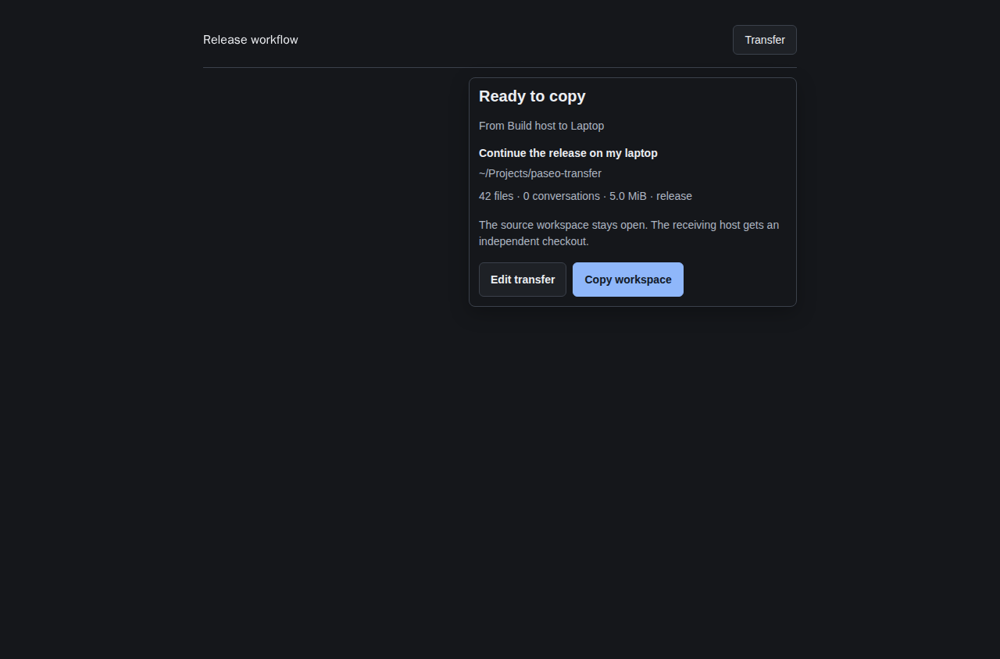

# paseo-transfer

[](https://www.npmjs.com/package/paseo-transfer)
[](https://www.npmjs.com/package/paseo-transfer)
[](https://paseo.sh)
[](LICENSE)

Copy or move a workspace to another host, with Git history, local changes, and Claude/Codex conversations.



Example using fixture workspace and host data.

## Install

Enable plugins in **Settings → Plugins**, then run on the host you transfer from:

```sh
paseo plugin install paseo-transfer
```

Requires Paseo **0.11.0+**, Node **22+**, Git, and Linux/macOS (or WSL) on both hosts. The receiving host needs a running Paseo daemon, SSH access, and its own provider CLIs and credentials. Only the host opening Transfer needs the plugin.

Formerly **Sync**. GitHub redirects the old repository URL. Existing installations keep their `sync` ID: use `paseo plugin update sync`. New installations use `paseo plugin update transfer`. Install one copy per host.

## Use

1. Open a workspace and press **Transfer** at the top right. Its popup selects that workspace for you.
2. Choose the receiving host from your SSH aliases or online Tailscale peers, or enter `user@host`. Use normal `ssh` once to trust a new host's key.
3. Choose a **new directory** on the receiving host and **Copy** or **Move**, then press **Preview transfer**.
4. Review the files, conversations, and destination, then press **Copy workspace** or **Move workspace**. Stop running agents before transferring.

**Copy** keeps the source open. **Move** archives it through Paseo only after verification; a managed source worktree may be removed. Git-ignored files stay on the source, so Move refuses worktrees containing them.

The popup can close while a transfer runs; reopen it to check progress. The sidebar is hidden by default. Enable it in **Settings → Plugins → Transfer → Display**, or use **⌘K / Ctrl+K → Transfer a workspace** for the full screen, including transfers into the current host.

## Data and recovery

Transfers use SSH and each host's existing Paseo authentication. Provider credentials, MCP settings, Git-ignored files, and launch settings stay on their original hosts. Each copy is an independent checkout.

Transfer refuses occupied destinations, changed previews, unsupported conversations, and unsafe paths. It verifies the destination before archiving a source and preserves registered partial transfers for recovery. Plugins run trusted, unsandboxed code.

See the [transfer details](docs/behavior.md) for supported content, limits, and failure handling.

## Development

```sh
npm ci
npm run verify
npm pack --dry-run
npx tsx scripts/ui-preview.tsx
```

Checks use isolated Paseo daemons, temporary Git repositories, and an encrypted SSH fixture. `npm run test:live` additionally transfers and resumes real provider conversations. Reload only this plugin with `paseo plugin reload transfer` (`sync` for an existing installation).

## License

[MIT](LICENSE). Rebuilt from [itsjustanks/paseo-plugin-sync](https://github.com/itsjustanks/paseo-plugin-sync); its original attribution is preserved.

## Other plugins

- [Defer](https://github.com/tomgrin10/paseo-defer) — Schedule messages for later delivery.
- [Graphite](https://github.com/tomgrin10/paseo-graphite) — Graphite stacks and PR status.
- [Smart Session](https://github.com/tomgrin10/paseo-smart-session) — Context compaction and usage insights.
- [Vitals](https://github.com/tomgrin10/paseo-vitals) — Host, agent, and Docker health.
- [Session Guard](https://github.com/tomgrin10/paseo-session-guard) — Pause at session limits and continue after reset.
- [Transcript Search](https://github.com/tomgrin10/paseo-transcript-search) — Search conversations across connected hosts.
- [Send to Paseo](https://github.com/tomgrin10/send-to-paseo) — Send GitHub and Graphite PRs to Paseo from Chrome.
- [Dispatch](https://github.com/tomgrin10/paseo-dispatch) — Route tasks to existing workspaces (development preview).
