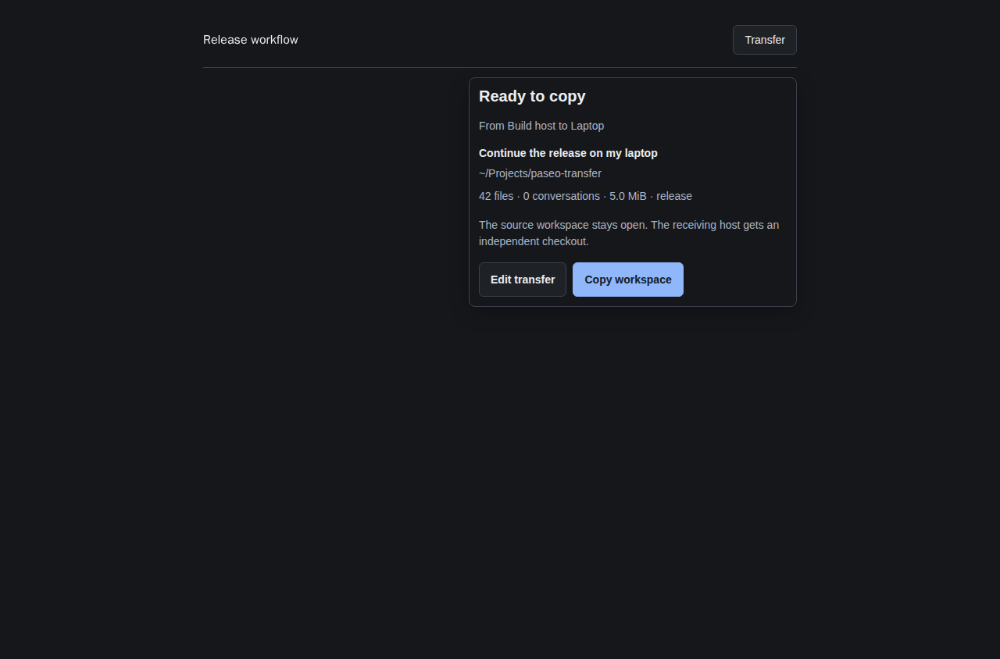

# paseo-transfer

[](https://www.npmjs.com/package/paseo-transfer)
[](https://www.npmjs.com/package/paseo-transfer)
[](https://paseo.sh)
[](LICENSE)

Copy or move a workspace to another host, with its Git history, local changes, and Claude and Codex conversations.



Example using fixture workspace and host data.

## Install

Run on both hosts:

```sh
paseo plugin install paseo-transfer
```

Both hosts need Node 22+, Git, and Linux, macOS or WSL. Connect both hosts in Paseo. The receiving host needs its own provider CLIs and credentials.

## Use

1. Stop running agents, open the workspace, and press **Transfer** at the top right.
2. Choose a connected host and a new directory. No pairing, passwords or SSH setup.
3. Choose **Copy** or **Move**, press **Preview transfer**, review, and start.

**Copy** keeps the source. **Move** archives it after the copy is verified. Keep Paseo open and both hosts connected until it finishes; reopen the popup to check progress. **⌘K / Ctrl+K → Transfer a workspace** opens the full screen, including incoming transfers.

Agents can list destinations with `transfer_list_hosts` and check progress with `transfer_run_status`. Starting a transfer still goes through the preview in the Transfer screen.

## Limits

- Git-ignored files, provider credentials, MCP settings and launch settings stay on the original host. Move refuses worktrees that contain ignored files.
- Transfer project workspaces, not your whole home directory.
- **Use SSH** reaches hosts without the plugin, using your SSH aliases, keys and host-key checks.

The [transfer details](docs/behavior.md) cover supported content and failure handling.

## Development

```sh
npm ci
npm run verify
paseo plugin reload transfer   # after changes
npm run test:live              # provider checks
```

## License

[MIT](LICENSE). Rebuilt from [itsjustanks/paseo-plugin-sync](https://github.com/itsjustanks/paseo-plugin-sync); its original attribution is preserved.

## Other plugins

- [Defer](https://github.com/tomgrin10/paseo-defer) — Schedule messages for later delivery.
- [Follow-up](https://github.com/tomgrin10/paseo-follow-up) — Track workspace PRs, remaining tasks and completion.
- [Graphite](https://github.com/tomgrin10/paseo-graphite) — Graphite stacks and PR status.
- [Send to Paseo](https://github.com/tomgrin10/send-to-paseo) — Send GitHub and Graphite PRs to Paseo from Chrome.
- [Session Guard](https://github.com/tomgrin10/paseo-session-guard) — Pause at session limits and continue after reset.
- [Smart Session](https://github.com/tomgrin10/paseo-smart-session) — Context compaction and usage insights.
- [Transcript Search](https://github.com/tomgrin10/paseo-transcript-search) — Search conversations across connected hosts.
- [Vitals](https://github.com/tomgrin10/paseo-vitals) — Host, process, agent and Docker monitoring.
- [Workspace Switcher](https://github.com/tomgrin10/paseo-switcher) — Arc-style Ctrl+Tab between recent workspaces.
