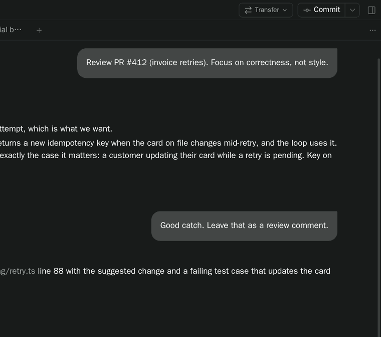
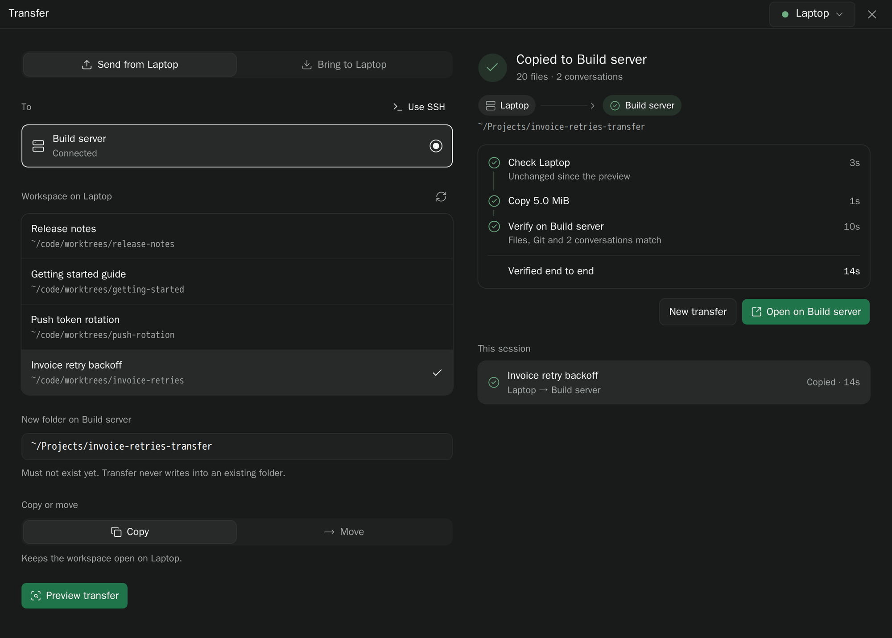
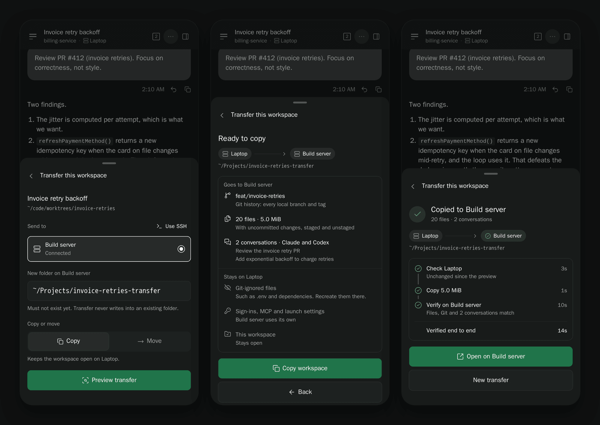
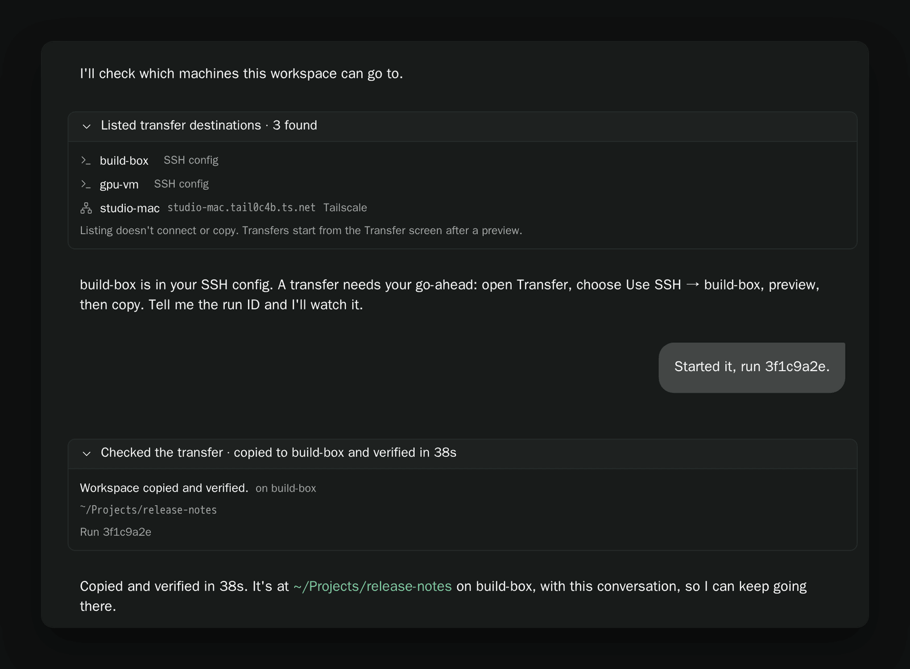

# paseo-transfer

[](https://www.npmjs.com/package/paseo-transfer)
[](https://www.npmjs.com/package/paseo-transfer)
[](https://paseo.sh)
[](LICENSE)

Copy or move a workspace to another host, with its Git history, local changes, and Claude and Codex conversations. Preview exactly what goes and what stays behind, watch each step land with its time, then open the workspace on the other host.

<picture>
  <source media="(prefers-color-scheme: light)" srcset="docs/media/transfer-hero-light.png">
  
</picture>

Screenshots and the GIF come from real transfers between two local test hosts, Laptop and Build server, with synthetic repositories and conversations. The GIF plays the waits for the hosts at 4× speed.

## Install

Run on both hosts:

```sh
paseo plugin install paseo-transfer
```

Both hosts need Node 22+, Git, and Linux, macOS or WSL. Connect both hosts in Paseo. The receiving host needs its own provider CLIs and credentials.

## Use

1. Stop running agents, open the workspace, and press **Transfer** at the top right. On a phone it's in the workspace's **···** menu.
2. Pick the host and a new folder there. Connected hosts show their status; nothing to pair, no passwords.
3. Choose **Copy** or **Move** and press **Preview transfer**. The preview lists what goes (branch, files with their uncommitted changes, each conversation) and what stays (Git-ignored files, sign-ins and MCP settings). Press **Copy workspace** or **Move workspace**.

Each step shows its own time: check the source, copy, verify and import on the destination, and archive the source for a move. You can close the popup; the Transfer button's icon fills as the steps land and ends in a check, and a toast says when it's done. Then **Open on** the other host takes you to the copy.



**Copy** keeps the source open. **Move** archives it only after the destination is verified. Keep Paseo open and both hosts connected until it finishes.

### When something stops

Preview problems sit next to their fix. A Move blocked by Git-ignored files offers **Use Copy instead**; an existing folder, running agents, and conversations that can't travel are named in plain words.

If a transfer stops, the popup says at which step, and where each copy is: the source is still open, and the destination is either removed or, when it was already registered, kept for recovery at the path shown. The provider's own error and the command output are under **Show details**.


### The Transfer screen

**⌘K / Ctrl+K → Transfer a workspace** (or **Transfer this workspace** inside one) opens the full screen: send a workspace from this host or bring one to it, the same receipt and steps, and this session's transfers. A sidebar row is available in Settings → Plugins → Transfer → Display.



**Use SSH** reaches hosts without the plugin, using your SSH aliases, keys and host-key checks. Suggestions come from your SSH config and online Tailscale peers.



### For agents

With Paseo tools enabled, Claude and Codex sessions get two read-only tools. Their calls show in the chat as one line each.

| Tool                  | What it does                                                           |
| --------------------- | ---------------------------------------------------------------------- |
| `transfer_list_hosts` | Lists SSH config and Tailscale destinations without connecting to them |
| `transfer_run_status` | Reads a transfer's progress and verification by run ID                 |

Starting a transfer always goes through the preview in the Transfer popup or screen.



## Limits

- Git-ignored files, provider credentials, MCP settings and launch settings stay on the original host. Move refuses worktrees that contain ignored files.
- Transfer project workspaces, not your whole home directory.
- Running agents, unsupported providers and missing transcripts block a transfer instead of dropping history.
- Connected transfers run in the app. Reloading the app or the plugin clears preview and status; check both hosts before retrying.

The [transfer details](docs/behavior.md) cover supported content and failure handling.

## Development

```sh
npm ci
npm run verify
paseo plugin reload transfer   # after changes
npm run test:live              # provider checks
```

## License

[MIT](LICENSE). Rebuilt from [itsjustanks/paseo-plugin-sync](https://github.com/itsjustanks/paseo-plugin-sync); its original attribution is preserved.

## Other plugins

- [Defer](https://github.com/tomgrin10/paseo-defer) — Schedule messages for later delivery.
- [Follow-up](https://github.com/tomgrin10/paseo-follow-up) — Track workspace PRs, remaining tasks and completion.
- [Send to Paseo](https://github.com/tomgrin10/send-to-paseo) — Send GitHub and Graphite PRs to Paseo from Chrome.
- [Session Guard](https://github.com/tomgrin10/paseo-session-guard) — Pause at session limits and continue after reset.
- [Smart Session](https://github.com/tomgrin10/paseo-smart-session) — Context compaction and usage insights.
- [Transcript Search](https://github.com/tomgrin10/paseo-transcript-search) — Search conversations across connected hosts.
- [Vitals](https://github.com/tomgrin10/paseo-vitals) — Host, process, agent and Docker monitoring.
- [Workspace Switcher](https://github.com/tomgrin10/paseo-switcher) — Arc-style Ctrl+Tab between recent workspaces.
